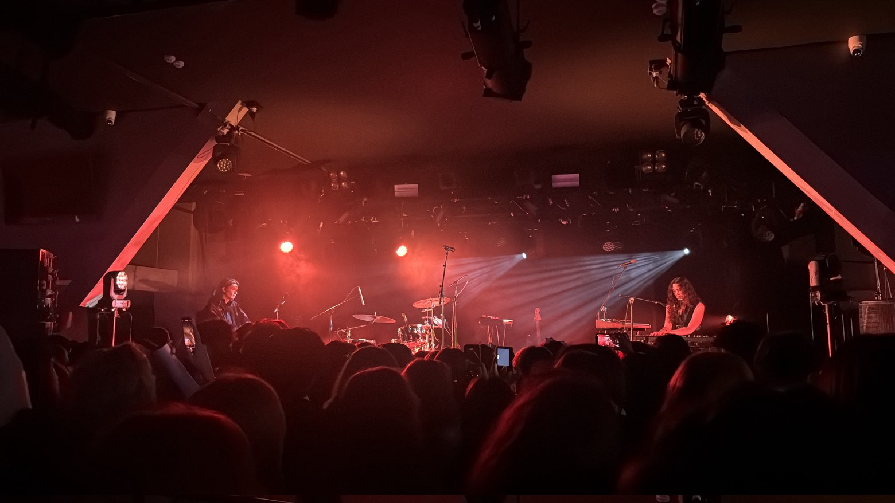
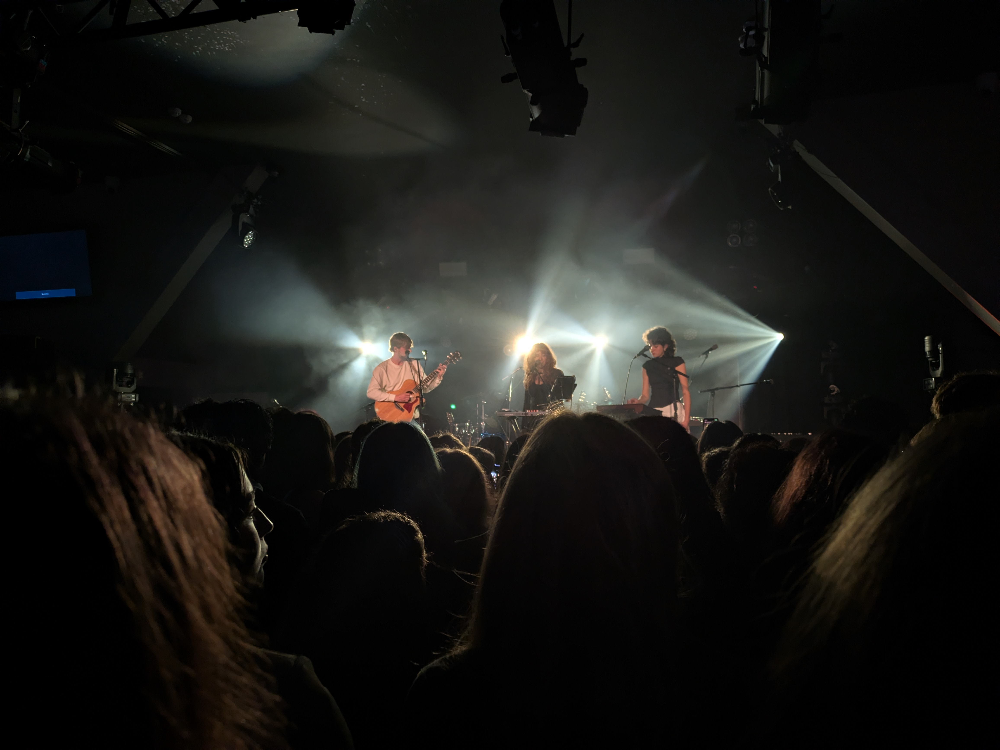
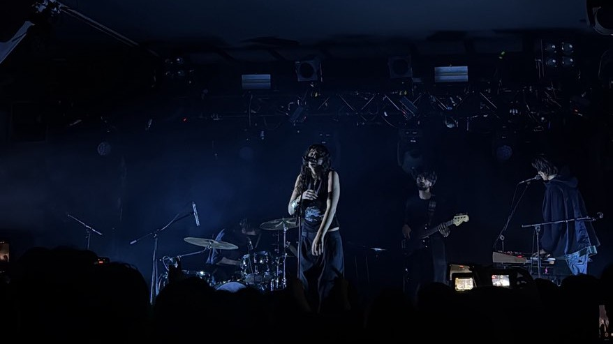
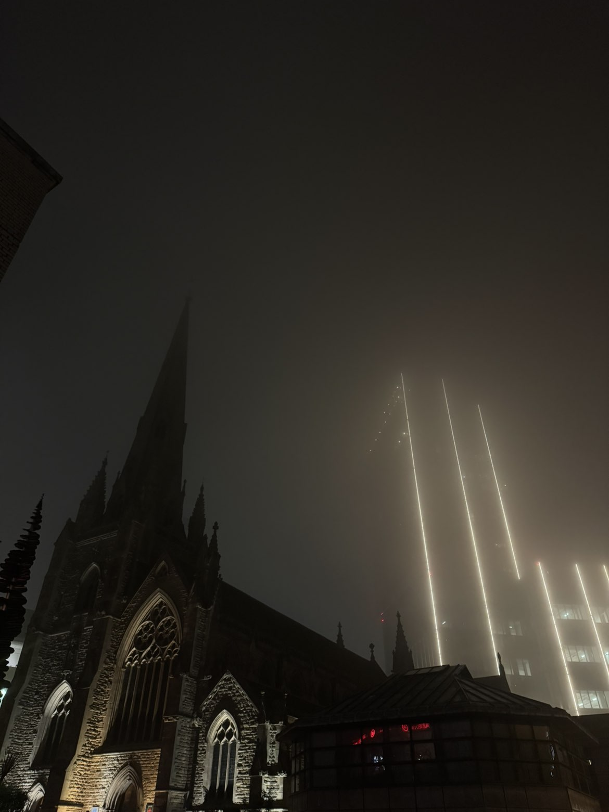
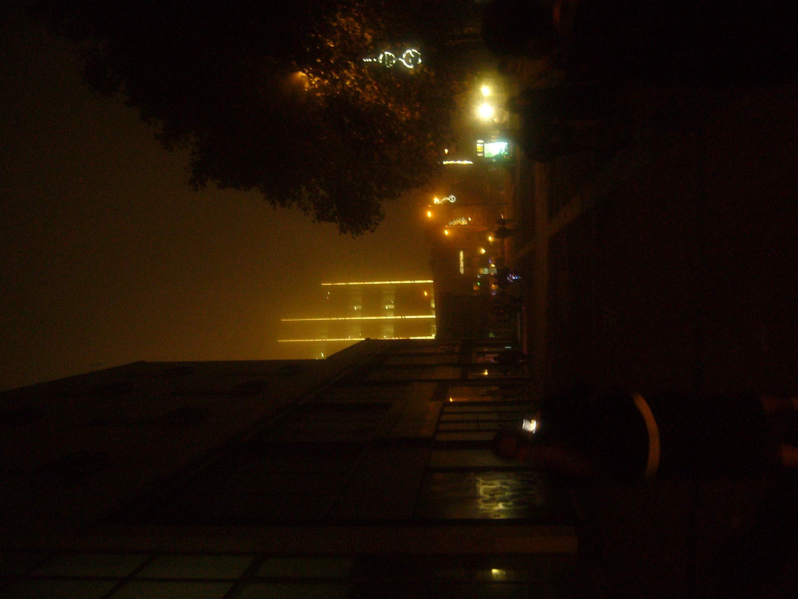

Going to a concert for the first time, and seeing Birmingham in the fog.

(Any good looking photos in this post were taken by my friend, my digicam couldn't cope with the bright lights, and all my good photos have their faces in)

I went to my first gig last night! Two of my friends and I went to go see Wasia Project live at the O2 institute in Birmingham and it was a blast! I drove us all from Worcester and managed to navigate all the way The Mailbox carpark without the satnav. We arrived around 4pm and spent some time walking round Birmingham, going shopping, etc. One of my friends has never properly visited Brum, so it was nice to show him around, especially with the German market running. Sadly as it was a Sunday, everything shut early, so I didn't get a chance to take him to library. After going to HMV and a few other shops, we got burritos from Tortilla for dinner then killed some time before the concert started.

We arrived 15 minutes early, but the queue was already halfway down the street. After waiting for a while, we went in, and had to wait another whole hour for the show to start (apparently this is normal, but, like, could they not just start if everyone is already in the venue?).

|  |
| *Lumi performing the warmup act* |

A band called Lumi was the opening act, one of the women said she grew up in Germany, so I guess that's where their from. They had great singing voices, and could do amazing harmonies, however, I wasn't a **huge** fan of their music. Still, it was cool to find a new band in an organic way.

|  |
| *Wasia Project!* |

Finally, two hours after the show's start time, Wasia Project came on. Whereas the previous band had been a comfortable volume, clearly audible over the crowd, while still being a reasonable volume, Wasia was **ABSOULETLY DEAFENING**. One friend had brought ear plugs, and the other had hearing aids, so they were both fine, however I have almost certainly damaged my hearing from the extremely loud performance (seriously, if you're gonna go to a gig, make sure to bring some kind of ear plugs just in case).

Despite this, it was a thorougly enjoyable experience, and completely different to listening to their music on MiniDisc, the radio or Spotify. The crowd was amazing, and you could really sense the emotion behind the music. If you ever get the chance to see a band you love (or just have remotely any interest in) live, **TAKE IT!**

|  |
| *Birmingham looking like a scene from Cyberpunk 2077 - my friend's photo* |

As we were walking to the O2, we got some great views of Birmingham in the dark fog. Many of the new skyscrapers are covered in lights like in Tokyo, and it give an AMAZING effect when it's foggy. Sadly, lots of the best buildings we passed where when I was driving home, so I couldn't get photos of them.

|  |
| *Birmingham looking like a scene from Cyberpunk 2077 - my photo* |
